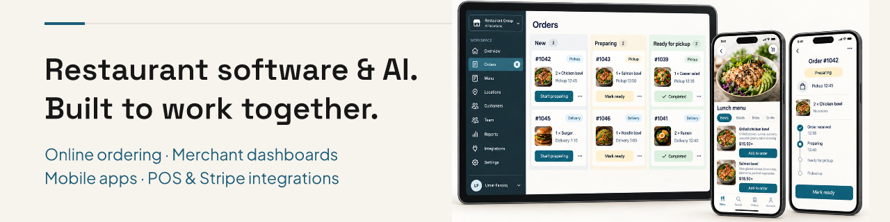

  

# Umar Farooq

**Restaurant ordering, POS integrations & SaaS engineering**

I build and repair ordering apps, merchant dashboards, POS integrations and practical AI features for restaurant software teams, and websites with online ordering for restaurant owners.

At Crave since May 2020, I progressed to Director of Engineering while remaining hands-on. My work spans customer ordering, merchant operations, mobile apps, shared services and Square/Clover integration engineering.

## Open source

Public code you can inspect, with my contribution history alongside each project:

- **[Loyalty Interchange Protocol](https://github.com/craveup-oss/loyalty-interchange-protocol)** — restaurant loyalty APIs, checkout and reward lifecycles, and integration tooling. [My contributions](https://github.com/craveup-oss/loyalty-interchange-protocol/commits/main/?author=mumar20) · [Tenant-isolation test example](https://github.com/craveup-oss/loyalty-interchange-protocol/commit/adc29c278686e3eec933bbaef13e7047b175d61b).
- **[CraveJS Storefront SDK for Dart](https://github.com/craveup-oss/cravejs-storefront-sdk-dart)** — typed building blocks for Flutter ordering apps, including carts, customer sessions and checkout handoffs. [My contributions](https://github.com/craveup-oss/cravejs-storefront-sdk-dart/commits/main/?author=mumar20) · [Cart lifecycle example](https://github.com/craveup-oss/cravejs-storefront-sdk-dart/commit/6ff24cc175bdd052b58bdee4cc5bdfc8443ca029).

These are Crave organization projects built with other contributors. **[StudyAI](https://github.com/mumar20/studyai)** is separate product-leadership proof: I owned direction, acceptance criteria and review; the project team implemented it.

## Selected restaurant work

- **[Mobile ordering for an 80-location restaurant brand](https://mumar.dev/case/restaurant-ordering-platform?utm_source=github)** — at Crave, I helped build and launch the guest app, connecting ordering, payments and loyalty. The client name remains private.
- **[CraveUp](https://mumar.dev/case/craveup-restaurant-platform?utm_source=github)** — checkout, merchant dashboards, React Native staff workflows, Star/Epson receipt printing and Square/Clover integration engineering within the Crave team.
- **[CaterVox](https://mumar.dev/case/catervox?utm_source=github)** — at Crave, I connected the catering voice assistant to restaurant menus and catering policies, and built location setup and estimate checks. The browser sandbox saves inquiries for staff to review and quote; commercial rollout is not claimed.
- **[Nomly](https://mumar.dev/case/ai-ops-copilot?utm_source=github)** — [Crave's AI assistant for restaurant operators](https://nomly.ai/). In 2026, I built tools that read current restaurant menus and opening hours, with location checks and clear handling of missing information. Earlier, in 2025, I built its document and email retrieval.
- **[Quick Food](https://mumar.dev/case/quick-food?utm_source=github)** — an ordering sandbox I lead, with hands-on checkout and cart engineering. It is not a client-results claim.

Most professional source is private. The case studies explain my role and show public/demo captures or sanitized diagrams, with their evidence boundaries.

`Next.js` · `React` · `TypeScript` · `Node.js` · `PostgreSQL` · `Flutter` · `React Native`

## Work with me

We start with one feature, integration or fix and agree one testable milestone in writing. If the cause is unclear, a focused review comes first. Each milestone ends with relevant tests and a reviewable handoff. Remote from Pakistan (UTC+5), with availability and overlap agreed for each project.

[Selected work](https://mumar.dev/work?utm_source=github) · [LinkedIn](https://www.linkedin.com/in/mumar20/) · [Discuss a project](https://mumar.dev/?utm_source=github#contact)

For non-restaurant websites and commerce, [Hassan leads that work](https://mumar.dev/business-websites?utm_source=github).
